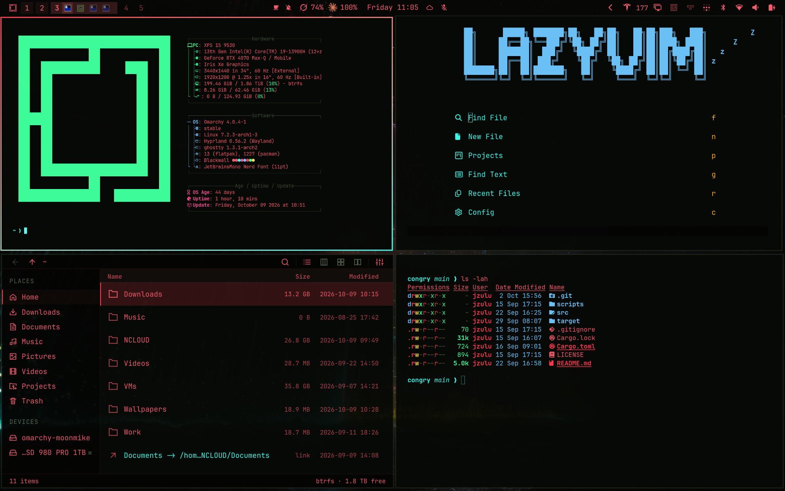

# Cyberpunk Blackwall

A dark [Omarchy](https://omarchy.org) theme. Near-black surfaces, red type, and a red-to-cyan window border. Gold marks anything that wants attention.



## Install

```bash
omarchy theme install https://github.com/zanonz/omarchy-cyberpunk-blackwall-theme
```

From the Omarchy menu (`Super + Space`): Install > Style > Theme, then paste that URL.

## Palette

| Role | Color |
| --- | --- |
| Background | `#070906` |
| Foreground | `#f25c6b` |
| Accent | `#ff3c4f` |
| Cyan | `#3dfff0` |
| Gold | `#ffe14a` |
| Green | `#3dff9a` |

The bar uses the same near-black at 80% opacity, so the top of the wallpaper shows through. Icons are Yaru Olive Dark.
